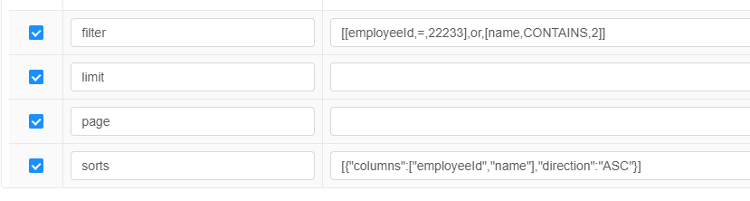

# com.travelsky.base.common.query.DevQueryVO 使用方法

## page
页码，从1开始

## limit
每页显示数量

## filter
该字段作用为可以对数据进行查询过滤。

格式为：[[column1,operator,value1],concat,[column2,operator,value2]]

其中 column1,column2 为字段名，如employeeId; value1,value2 为字段值，如 12345；

重点描述一下 operator 及 concat 两个字段；

- operator: 操作符，用于创建判断条件，有以下值：
    - `=`: 相等
    - `!=`,`<>`: 不等于
    - `CONTAINS`,`LIKE`: 包含
    - `RIGHT`,`LIKE_RIGHT`: 右边相似
    - `LEFT`,`LIKE_LEFT`: 左边相似
    - `>`: 大于
    - `>=`: 大于等于
    - `<`: 小于
    - `<=`: 小于等于
    - `BETWEEN`: 在 两者之间  **格式有所变化**: [column1,BETWEEN,value1,value2] 代表column1在value1，value2之间
    - `IN`: 在指定集合内  **格式有所变化**: [column1,IN,value1,value2,...,valueN] 代表column1在[value1,value2,...,valueN]集合内
    - `NOT_IN`,`NOTIN`: 不在指定集合内  **格式有所变化**: [column1,NOT_IN,value1,value2,...,valueN] 代表column1不在[value1,value2,...,valueN]集合内
    - `NULL`,`ISNULL`: 为空  **格式有所变化**: [column1,NULL] 代表column1为空
    - `NOT_NULL`,`NOTNULL`: 不为空  **格式有所变化**: [column1,NOT_NULL] 代表column1不为空

- concat:
    - and: 代表and两边的条件需要同时满足；可以省略，如 [[column1,operator,value1],[column2,operator,value2]]
    - or: 代表or两边的条件任意满足一条即可；需要显示指定，如 [[column1,operator,value1],or,[column2,operator,value2]]


**注意点**
1. 最外层的[] 不能省略，如 [column1,operator,value1],[column2,operator,value2] 不会被解析
2. 内层[] 可以多级嵌套，如 [[column1,operator,value1],[column2,operator,value2],[[column3,operator,value3],or,[column4,operator,value4]]], 会被解析为sql条件： where column1 operator value1 and column2 operator value2 and (column3 operator value3 or column4 operator value4);
3. [] 必须对应

### 示例

表 employee_info 数据如下
| employee_id  | name | age | 
|--------------|------|-----|
| 10086        | tom  | 22  |
| 10087        | jerry| 23  |
| 10088        | john | 22  |
| 10089        | tom  | 28  |

- 查询工号为 10086 的数据：[[employeeId,=,10086]]

- 查询工号为 10086,10087 的数据：[[employeeId,in,10086,10087]]

- 查询姓名为tom或john 的数据：[[name,=,tom],or,[name,=,john]]

- 查询姓名为tom且age为28 的数据：[[name,=,tom],[age,=,28]]

# sorts
该字段作用为可以对数据进行排序。

该数据格式为SortVO类的Json格式
```java
public class SortVO implements Serializable {

    private String[] columns;  // 列名数组
    private Type direction;   // 方向： 升序ASC，降序DESC

    public String[] getColumns() {
        return columns;
    }

    public void setColumns(String[] columns) {
        this.columns = columns;
    }

    public Type getDirection() {
        return direction;
    }

    public void setDirection(Type direction) {
        this.direction = direction;
    }

    public enum Type {
        ASC, DESC,
    }
}
```

即："[{"columns": ["column1","column2"], "direction": "ASC"}]"  代表 根据column1，column2 升序排序

**注意点**：
1. 最外层的"[]"不能省略,因为排序是个有序集合
2. columns对应的也是个数组，"[]"不能省略
3. "[{"columns": ["column1","column2"],"direction": "ASC"}]"
    - 等效 "[{"columns":["column1"],"direction": "ASC"}, {"columns": ["column2"],"direction": "ASC"}]"
4. "[{"columns": ["column1","column2"],"direction": "ASC"}, {"columns": ["column3"],"direction": "DESC"}]" 
    - 等效 "[{"columns": ["column1"],"direction": "ASC"}, {"columns":["column2"],"direction": "ASC"}, {"columns": ["column3"],"direction": "DESC"}]"，
    - 不等效 "[{"columns": ["column1"],"direction": "ASC"}, {"columns": ["column3"],"direction": "DESC"}, {"columns": ["column2"],"direction": "ASC"}]"

## 截图
